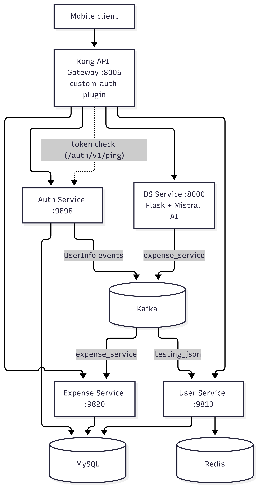

# Expense Tracker: Event-Driven Microservices Backend

An expense tracking backend built as independent services that communicate through Kafka. Raw bank SMS text is parsed by an LLM into structured expense records, and every request passes through an API gateway that validates a JWT before it reaches a service.


## Highlights

- **Event-driven core path.** The SMS-to-expense flow is fully asynchronous. The DS service publishes to Kafka and the Expense service consumes and persists, with no service-to-service HTTP calls on the hot path.
- **LLM integration.** Mistral AI (via LangChain) extracts amount, merchant and currency from raw SMS text, and non-bank messages are filtered out before the model is called.
- **Distributed-systems patterns.** Redis distributed locking, idempotent consumers, and manual Kafka offset commits that happen only after a successful database write.
- **Centralised authentication.** A custom Kong Lua plugin validates the JWT on every protected route by calling the Auth service, so individual services do not each re-implement gateway-level checks.
- **Reproducible deployment.** The entire stack runs from two Compose files and is deployed to AWS EC2 from a dedicated deployment repository.

## Architecture
<p align="center">
  
</p>

**Core flow: SMS to expense**

1. The client sends a bank SMS to `POST /v1/ds/message` through Kong.
2. Kong validates the JWT by calling the Auth service.
3. The DS service filters the message, calls Mistral AI, and builds a structured `ExpenseDto`.
4. The DS service publishes the expense to the `expense_service` Kafka topic.
5. The Expense service consumes the event and persists it to MySQL.

## Services

| Service | Port | Stack | Responsibility |
|---|---|---|---|
| Auth | 9898 | Spring Boot, MySQL | Signup, login, JWT issue and refresh, RBAC, publishes user events |
| User | 9810 | Spring Boot, Kafka, Redis | Consumes user events, idempotent profile create/update |
| Expense | 9820 | Spring Boot, Kafka, MySQL | Expense CRUD, date-range queries, consumes parsed expenses |
| DS | 8000 | Flask, LangChain, Mistral AI | SMS parsing and expense event publishing |
| Kong | 8005 | Kong (DB-less) | Single public entry point, JWT validation plugin |

### Auth Service
- JWT access tokens (24 h) and refresh tokens (7 days)
- Role-based access control through Spring Security
- BCrypt password hashing
- `/auth/v1/ping` endpoint used by the Kong plugin for token validation
- Publishes a `UserInfo` event to Kafka on signup

### User Service
- Consumes user registration events from Kafka
- Redis distributed lock prevents duplicate processing
- Idempotent create/update of user profiles
- Offsets are committed manually, only after a successful database write

### Expense Service
- Full CRUD for expenses
- Date-range queries backed by a composite index on `(user_id, created_at)`
- Handles both direct API calls and asynchronous Kafka events

### DS Service
- Accepts raw bank SMS text
- Keyword filter skips non-bank messages before any LLM call
- Mistral AI extracts amount, merchant and currency
- Lazy LLM initialisation, so the service starts even if Mistral is unreachable

### Kong Gateway
- DB-less declarative configuration (`config/kong.yml`)
- Custom `custom-auth` Lua plugin on all protected routes
- Public routes: signup, login, refreshToken, ping
- Every other route requires a `Bearer` token

## Tech Stack

| Layer | Technology |
|---|---|
| Services | Java 21, Spring Boot 3.x, Spring Security, Spring Data JPA, Gradle |
| Gateway | Kong with a custom Lua plugin |
| Messaging | Apache Kafka 4.2 (KRaft, no ZooKeeper) |
| Cache and locking | Redis 7 |
| Database | MySQL 8.3 |
| AI | Python 3.11, Flask, LangChain, Mistral AI |
| Packaging | Docker, Docker Compose |
| Hosting | AWS EC2 (Ubuntu 24.04 LTS) |

## API Reference

All requests go through Kong at `http://<host>:8005`.

**Auth (public)**

```
POST  /auth/v1/signup          Register, returns JWT + refresh token
POST  /auth/v1/login           Login, returns JWT + refresh token
POST  /auth/v1/refreshToken    Exchange a refresh token for a new access token
GET   /auth/v1/ping            Token validation endpoint used by Kong
```

**User (protected)**

```
POST  /user/v1/createUpdate    Create or update the user profile
GET   /user/v1/getUser         Get the authenticated user's details
```

**Expense (protected)**

```
POST    /expense/v1/create     Create an expense manually
GET     /expense/v1/get        List the user's expenses
GET     /expense/v1/get/range  List expenses in a date range
PUT     /expense/v1/update     Update an expense
DELETE  /expense/v1/delete     Delete an expense
```

**DS (protected)**

```
POST  /v1/ds/message           Send raw SMS, AI-parsed into an expense
```

## Kafka Topics

| Topic | Producer | Consumer | Purpose |
|---|---|---|---|
| `testing_json` | Auth Service | User Service | User registration events |
| `expense_service` | DS Service | Expense Service | Parsed expense events |

## Running Locally

### Prerequisites
- Docker and Docker Compose v2
- A Mistral AI API key (console.mistral.ai)

### Steps

```bash
git clone https://github.com/Meraj-del/expense-tracker-app-microservices.git
cd expense-tracker-app-microservices
```

Create a `.env` file next to `docker-compose.yml`. It is git-ignored and must never be committed.

```bash
MYSQL_ROOT_PASSWORD=change-me
MYSQL_USERNAME=root
MYSQL_PASSWORD=change-me
JWT_SECRET=<base64-encoded 256-bit secret>
MISTRAL_API_KEY=<your key>
```

The DS service image also reads a `.env` in its build folder (`jar/.env`) containing `MISTRAL_API_KEY`.

Start everything:

```bash
chmod +x start-all.sh
./start-all.sh        # backend stack, then Kong
./start-all.sh stop   # tear down
```

Smoke test:

```bash
curl -X POST http://localhost:8005/auth/v1/signup \
  -H "Content-Type: application/json" \
  -d '{"username":"testuser","email":"test@test.com","password":"Test@1234","firstName":"Test","lastName":"User"}'
```

## Deployment (AWS)

The stack runs on a single **AWS EC2** instance using the same Docker Compose files as local development, so the cloud environment matches the one the services were tested in.

```
Internet ──► EC2 public IP :8005 ──► Kong ──► private Docker network
                                              ├─ Auth / User / Expense / DS
                                              └─ MySQL / Redis / Kafka
```

| Item | Detail |
|---|---|
| Host | EC2, Ubuntu Server 24.04 LTS, x86_64 |
| Runtime | Docker and Docker Compose (Java 21 and Python 3.11 are provided by the container images) |
| Orchestration | `docker-compose.yml` (backend) and `kong.yml` (gateway), started in order by `start-all.sh` |
| Gateway config | `config/kong.yml` and `custom-plugins/custom-auth/` mounted into the Kong container |
| Delivery | Built jars and Dockerfiles are kept in a private deployment repository and cloned onto the instance |
| Secrets | `.env` files are created on the server and are never committed to Git |

**Network exposure**

| Port | Open to | Purpose |
|---|---|---|
| 22 | Admin IP only | SSH |
| 8005 | Public | Kong proxy, the only application entry point |
| 3306, 6379, 9092 | Not exposed | MySQL, Redis, Kafka stay on the private Docker network |
| 9898, 9810, 9820, 8000 | Not exposed | Services are reachable only through Kong |
| 8001, 8444 | Not exposed | Kong Admin API |

**Deploying to a new server**

```bash
# on the EC2 instance
sudo apt update && sudo apt install -y docker.io docker-compose-v2 git
git clone https://github.com/Meraj-del/<deployment-repo>.git
cd <deployment-repo>
# create .env and jar/.env, then:
chmod +x start-all.sh && ./start-all.sh
curl http://<EC2_PUBLIC_IP>:8005/auth/v1/ping
```

## Security

- Secrets are supplied through environment variables and `.env` files, never hardcoded or committed.
- Passwords are hashed with BCrypt.
- Access tokens are signed JWTs (HS256) with a 24-hour expiry. Kong rejects requests to protected routes without a valid token.
- Authorisation is enforced in the services with Spring Security and `@PreAuthorize`.
- Only the gateway port is public. The database, cache, broker and Kong admin API are not reachable from the internet.
- Redis distributed locks prevent concurrent duplicate processing.

## Known Limitations and Roadmap

- **No TLS yet.** Traffic to port 8005 is plain HTTP. Planned: a domain and TLS termination (Caddy, Nginx or an AWS load balancer with ACM).
- **Single node.** Everything runs on one instance, so there is no high availability. Planned: managed MySQL (RDS) and Redis (ElastiCache), plus multiple Kafka brokers.
- **Load testing** has not been done against the cloud deployment.
- **CI/CD.** Deployment is currently manual. Planned: GitHub Actions to build the jars and images and deploy on push.

## Contact

**Md Meraj**, Java Backend Engineer, Delhi, India

- Email: mdmeraj260261@gmail.com
- GitHub: [github.com/Meraj-del](https://github.com/Meraj-del)
- LinkedIn: [linkedin.com/in/md-meraj-74a595323](https://linkedin.com/in/md-meraj-74a595323)
